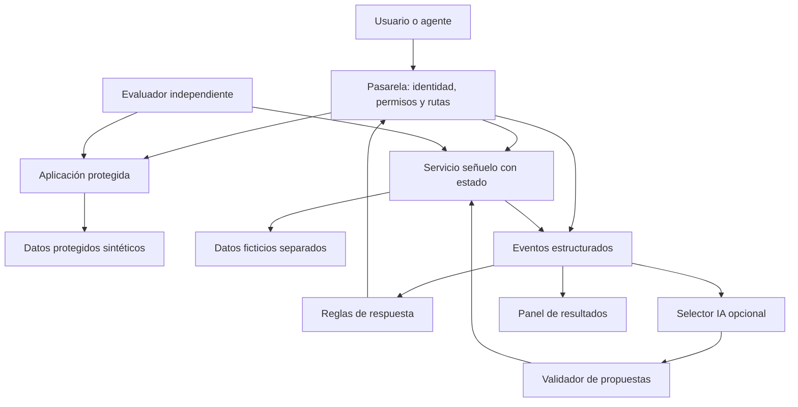

# Arquitectura inicial

**Actualización 13/11/2026:** arquitectura OBJETIVO. La v0.1 implementa el flujo en un proceso Python con separación lógica. No hay todavía separación física, selector IA, panel ni contenedores. Código: `dedalo/core.py`, `dedalo/server.py`; verificación: `dedalo/demo.py`, `tests/test_lab.py`.

## Escenario y amenaza

Una aplicación de proyectos y documentos tiene usuarios con permisos diferentes. Un agente puede intentar leer documentos ajenos, utilizar una credencial encontrada o abusar de una exportación. Todos los objetivos, datos y herramientas pertenecen al laboratorio. El atacante no administra la pasarela, la política ni el evaluador.

No se supone que el atacante seguirá un señuelo. Los permisos siguen aplicándose si lo ignora. Los documentos protegidos también son sintéticos: “real” significa recurso protegido del experimento, no datos personales.

## Flujo



## Componentes

| Pieza | Responsabilidad | Restricción |
|---|---|---|
| Pasarela | Resolver identidad y aplicar permisos; distinguir credenciales reales y señuelo | El cliente nunca elige el nivel de confianza ni aporta la identidad que se va a revocar. |
| Aplicación | Listar y leer documentos; exportación mínima | El backend vuelve a comprobar permisos; no basta con ocultar rutas. |
| Espejos | Emitir un token señuelo por ubicación o sesión | Nunca válido en la aplicación protegida; registrar identificador, no secreto completo. |
| Laberinto | Proyecto ficticio → exportación ficticia → archivo ficticio | Estado estable por sesión; sin acceso al almacenamiento protegido. |
| Arqueros | Revocar sesiones vinculadas con evidencia; limitar frecuencia | Límites por identidad verificada; no bloquear usuarios distintos solo por compartir IP. |
| Evaluador | Comprobar acceso, estado, utilidad y costos | No acepta la declaración de éxito del atacante o defensor como evidencia. |

## Aislamiento

El ensayo local utilizará servicios separados y datos sintéticos. Solo la pasarela publicará el acceso de prueba. El señuelo no tendrá credenciales, volúmenes ni conexiones hacia los datos protegidos, ni salida libre a Internet. El atacante operará con herramientas HTTP de destinos permitidos, sin shell arbitraria.

Los contenedores son una facilidad de empaquetado, no una prueba de aislamiento contra ejecución de código hostil. La primera versión evalúa solicitudes a la aplicación, no escapes del sistema operativo.

## Estados y correlación

Estado de sesión real: activa → restringida → revocada. Estado del señuelo: inicio → proyecto → exportación → cierre por presupuesto.

Si un token señuelo fue servido a una sesión autenticada y luego se usa, hay una vinculación registrada por el servidor. Si el señuelo es público o compartido, no permite atribuir su uso a una cuenta real: solo se limita la sesión señuelo y se genera una alerta. Un cliente no puede indicar “revoca a este otro usuario”.

El Laberinto no devuelve la sesión revocada al backend protegido. La caída de la IA no altera autorizaciones: se elige una rama fija. La caída del servicio señuelo produce un error controlado sin redirigir hacia producción.

## Contratos para trabajar en equipo

Evento: `run_id`, `event_id`, `timestamp`, `session_ref`, `actor_ref`, `route`, `resource_ref`, `decoy_id`, `decision`, `reason`, `latency_ms`. Identidades asignadas por servidor; texto externo identificado como no confiable. No almacenar claves ni datos personales en las trazas.

Propuesta IA: `branch_id`, `reason`, `budget_remaining`. `branch_id` debe pertenecer al catálogo. La propuesta no contiene código ejecutable, direcciones externas ni cambios de permisos. La explicación no se trata como evidencia.

Acción defensiva: `action`, `target_session_ref`, `evidence_event_id`, `expires_at`. El motor verifica que el evento esté vinculado al objetivo. Acciones iniciales: restringir y revocar. Restauración: explícita y registrada.

## Estructura objetivo para una siguiente versión con servicios separados

```text
gateway/       identidad, permisos y respuestas defensivas
protected_app/ aplicación de documentos
decoy/         Espejos, Laberinto y estado ficticio
evaluation/    ejecutor y evaluador independiente
scenarios/     tareas benignas y adversarias
dashboard/     lectura de eventos, sin autoridad para calificar resultados
tests/         separación, autorización, correlación y continuidad
```

Primera integración reutilizable: APIs HTTP. Cada aplicación deberá mapear sus rutas, permisos y mecanismo de revocación. Una segunda aplicación sencilla permitirá comprobar qué parte es portable. No se promete instalación universal.

## HTER

El README privado revisado describe HTER-AUTH como una plataforma de investigación de autorización con planificación, ejecución y verificación, además de un motor de investigación. No se ejecutó ni auditó su implementación en esta preparación.

DÉDALO será independiente. Más adelante HTER podría producir casos de autorización o consumir trazas mediante un adaptador, si se validan sus contratos y funciona con el presupuesto del laboratorio. No se copiará el repositorio privado completo a una entrega pública.
