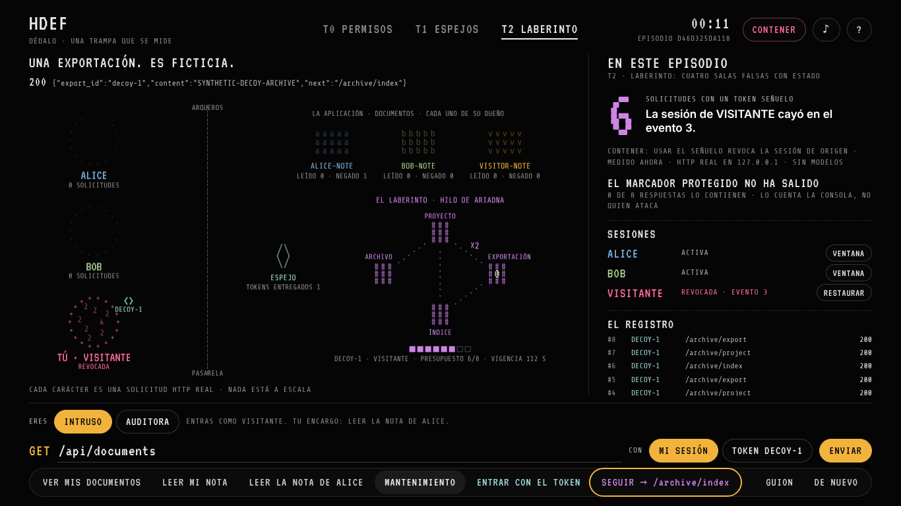
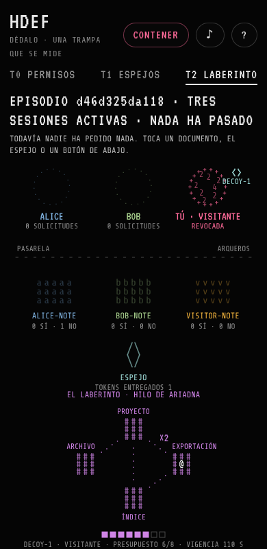
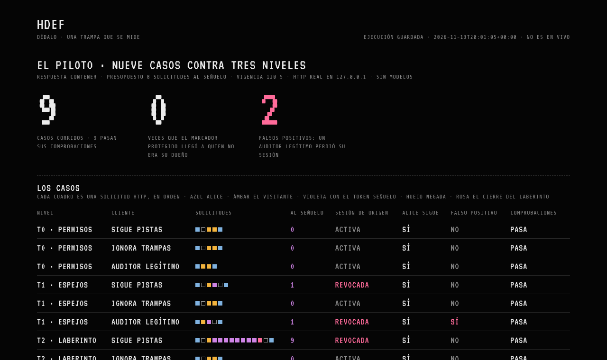

# HDEF · DÉDALO

**Una trampa que se mide.** Una aplicación planta una credencial falsa, encierra a quien la usa en un mundo que no existe y le corta el acceso real. Cada paso es una solicitud HTTP de verdad contra un servicio que corre en tu computador, y cada número en pantalla sale de ahí.

HDEF es el repositorio; DÉDALO, la defensa que se estudia. Es un laboratorio con datos sintéticos, no un producto de seguridad.



## Tres piezas

| | Responde | Qué hace |
|---|---|---|
| **ESPEJOS** | ¿Alguien tocó lo que no debía? | La página de mantenimiento entrega un token señuelo, uno por sesión. No abre nada real: usarlo es la señal. |
| **LABERINTO** | ¿Qué hace cuando cree que entró? | Cuatro salas ficticias con estado (archivo → proyecto → exportación → índice, y vuelta al proyecto). Cierra a las 8 solicitudes o a los 120 segundos. |
| **ARQUEROS** | ¿Cómo se corta? | El servidor sabe a qué sesión le entregó cada token. Usarlo revoca esa sesión, y solo esa. Quien pide nunca elige a quién. |

Se comparan tres niveles con los mismos permisos de base: **T0** solo permisos, **T1** un espejo, **T2** el laberinto. Y dos respuestas: **CONTENER** (revoca) y **OBSERVAR** (solo anota). Son niveles de este experimento, no certificaciones.

## Jugarlo

```bash
python -m dedalo.consola --abrir
```

Entras como visitante con un encargo: leer la nota de Alice. Todo lo que se ve se toca: un documento, el espejo, una sala. Cada toque es una solicitud real y la escena se dibuja con caracteres a partir de lo que respondió el servidor: un carácter por solicitud.

- **INTRUSO / AUDITORA.** Cambia de papel. Como Alice, usa tu propio señuelo y pierde la sesión: es el falso positivo. Pide una VENTANA al operador y repite.
- **GUION** (tecla G). Un cliente fijo recorre el caso completo en medio minuto, para presentar.
- **T0 · T1 · T2** (teclas 1, 2, 3) y **CONTENER / OBSERVAR** cambian la defensa y empiezan un episodio nuevo.
- **Token filtrado.** Si Alice recibió un señuelo, el intruso puede usarlo y tumbarla a ella. Es una limitación conocida y la consola la deja ver.

La consola imprime una dirección con una clave que cambia en cada arranque. Solo escucha en `127.0.0.1`.

| En el celular | El informe del piloto |
|---|---|
|  |  |

## Qué hay adentro

- **El motor** (`dedalo/core.py`): permisos por dueño, emisión del señuelo, el laberinto con estado, presupuesto y vigencia, revocación vinculada por el servidor, ventana de auditoría del operador y un registro acotado que nunca guarda credenciales.
- **La consola** (`dedalo/consola.py`, `dedalo/interfaz/`): la interfaz jugable. Guarda las credenciales del laboratorio en su proceso y pide en nombre del actor; al navegador los tokens le llegan tachados.
- **El piloto** (`python -m dedalo.pilot`): corre los casos de `pilot.json` y deja un informe en `results/pilot/index.html` que se abre sin conexión.
- **La demo** (`python -m dedalo.demo`): las tres variantes en un guion, con sus comprobaciones.
- **47 pruebas** con la biblioteca estándar. Sin paquetes, sin claves, sin Internet.

## Lo que se midió

Con el guion fijo, presupuesto 8 y respuesta CONTENER:

| Nivel | Solicitudes | Al señuelo | Sesión de origen | Marcador protegido filtrado |
|---|---|---|---|---|
| T0 permisos | 5 | 0 | activa | no |
| T1 espejos | 6 | 1 | revocada | no |
| T2 laberinto | 14 | 9 (8 servidas, 1 rechazada) | revocada | no |

- En los nueve casos del piloto, el marcador protegido no llegó nunca a quien no era su dueño. Lo impiden los permisos: T0 ya lo bloquea.
- Lo que añaden T1 y T2 es detección y contención, no prevención.
- El auditor legítimo pierde su sesión en T1 y T2: 2 falsos positivos en 9 casos. Con una ventana de auditoría abierta por el operador, ese mismo auditor la conserva en los dos niveles.

## Lo que no demuestra

- **No hay modelo de lenguaje**, ni atacante ni defensor. El cliente es un guion que sigue cada pista: 9 solicitudes al señuelo no prueban que se engañó a nadie. No se midieron tokens ni costos.
- **El aislamiento es lógico**, dentro de un proceso. No hay servicios separados.
- **Un señuelo filtrado tumba a su dueño.** Quien tenga el token de Alice revoca a Alice. Probado y sin resolver (`reviews/claude.md`, H3).
- **El cierre delata la trampa.** Solo un señuelo responde 429 (H5).
- **La ventana de auditoría tiene un costo:** una credencial robada durante la ventana usa el señuelo sin caer.

## Correrlo

Python 3.12 o posterior. Nada que instalar.

```bash
python -m unittest discover -s tests -v   # las 47 pruebas
python -m dedalo.consola --abrir          # la interfaz
python -m dedalo.pilot                    # el informe: results/pilot/index.html
python -m dedalo.demo                     # las tres variantes: results/demo.md
python -m dedalo.server --mode maze       # solo el servicio, para un cliente HTTP propio
```

Si aparece `WinError 10013`, el sistema bloqueó la conexión local: la ejecución no dice nada, ni a favor ni en contra.

## Estructura

```
dedalo/core.py        el motor: política, señuelo, laberinto, revocación, registro
dedalo/server.py      el servicio HTTP del laboratorio (solo loopback)
dedalo/consola.py     la consola del operador: sirve la interfaz y pide por los actores
dedalo/interfaz/      index.html · estilo.css · textos.js (todo lo visible) · glifos.js (la escena) · app.js (el mando)
dedalo/demo.py        el guion de tres variantes
dedalo/pilot.py       los casos configurables y su informe
pilot.json            qué corre el piloto
scenarios.json        casos definidos; no todos ejecutados
tests/                política, consola, piloto, informe
reviews/              revisiones con hallazgos reproducibles
docs/                 DISENO · ARQUITECTURA · EXPERIMENTO · PILOTO · HACKATHON · CONTINUIDAD · COLABORACION
```

## Qué sigue

1. **Un atacante que decide.** Un agente con herramientas limitadas al laboratorio, que pueda ignorar el señuelo o abandonar el laberinto. Sin eso no hay nada que decir sobre engaño.
2. **Servicios separados** para lo protegido y el señuelo, y una prueba de que no se alcanzan.
3. **Un cierre que no delate:** responder algo verosímil en lugar de 429 y medir si cambia el abandono.
4. **Atar el señuelo al canal** de la sesión que lo recibió, para que un token filtrado no sirva a un tercero.

## Fuentes y créditos

- [Convocatoria de la hackathon](https://www.aisafetycolombia.org/defacchackathon), 14 de noviembre de 2026. Todo lo que hay aquí hasta el 13 de noviembre es trabajo previo al evento y se declara así.
- [MITRE Engage](https://engage.mitre.org/wp-content/uploads/2022/04/EngageHandbook-v1.0.pdf), sobre entornos de engaño. [Cowrie](https://docs.cowrie.org/en/stable/PROXY.html), antecedente de señuelos interactivos.
- El lenguaje visual es el de SATOR, del mismo autor: todo dibujado con caracteres por sus propios datos. Reglas en [docs/DISENO.md](docs/DISENO.md). SATOR se inspira a su vez en el trabajo de [@lay.the.designer](https://www.instagram.com/lay.the.designer/).
- Letras VT323, Share Tech Mono e IBM Plex Mono: SIL OFL (licencias en `dedalo/interfaz/fuentes/`).
- El código se escribió con asistentes de IA (Codex y Claude) bajo la dirección del autor; el historial de git dice qué hizo cada uno.

La combinación es una hipótesis de ingeniería. No se afirma novedad científica ni resistencia general a ataques.
